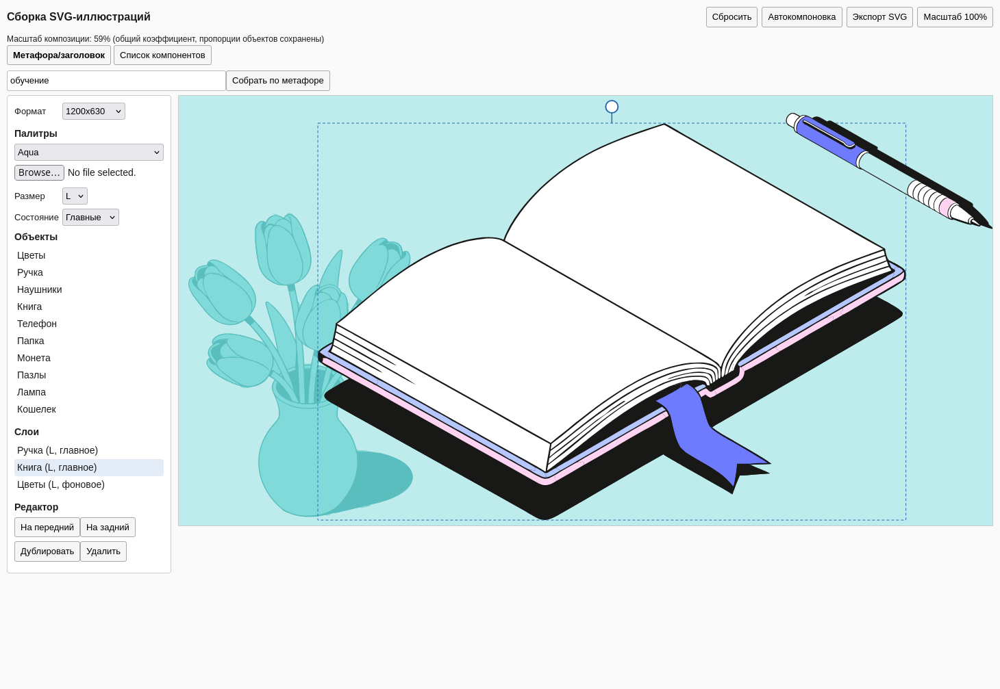

# Сборка SVG-иллюстраций

Веб-сервис, который собирает иллюстрации из готовых векторных объектов библиотеки.

Композиция состоит **только** из элементов исходных SVG-объектов: сервис не генерирует и не дорисовывает
новые объекты, ничего не растягивает и не меняет пропорции. AI используется исключительно для
анализа метафоры — он выбирает, какие существующие объекты подходят.



*Композиция по метафоре «обучение»: Книга и Ручка — главные объекты, Цветы — фоновый слой.
Схема Aqua, формат 1200×630, у выбранной Книги видна ручка поворота.*

---

## Возможности

- **Сценарий 1 — метафора или заголовок.** LLM анализирует текст и подбирает объекты из библиотеки.
- **Сценарий 2 — список компонентов.** Пользователь вводит названия, сервис собирает композицию.
  Поиск работает по названию, `assetId`, синонимам и тегам, без учёта регистра. Названия можно
  разделять запятыми, точками с запятой, пробелами или переносами строк.
- **Enter отправляет форму** «Собрать по метафоре» или «Собрать по списку».
- **40 SVG-объектов:** 10 типов × 2 состояния (главное / фоновое) × 2 размера детализации (L / S).
- **Редактор:** перемещение, поворот, дублирование, удаление, управление порядком слоёв.
- **Три формата:** 1000×1000, 1200×630, 800×1200. Смена формата перекладывает композицию
  только после подтверждения.
- **Автоматическая компоновка:** выбирает лучший вариант из ряда, колонки и сетки
  (2×2, 3×2 и т.д.) для любого количества главных объектов.
- **Подтверждения и загрузка:** смена формата, сброс сцены и удаление объекта выполняются
  через модальный диалог; кнопки генерации блокируются, пока идёт запрос.
- **Автоматическая композиция — 1–3 главных объекта.** Лимит жёстко действует для
  подбора по метафоре и по списку компонентов.
- **Ручная сборка не ограничена жёстко:** при 4+ главных объектах показывается
  неблокирующее предупреждение, а автокомпоновка при необходимости уменьшает сцену.
- **Палитры:** Purple, Warm, Aqua + импорт пользовательской палитры из JSON. Перекраска идёт по
  цветовым ролям, поэтому схему можно менять в один клик.
- **Информация об ответе LLM** под холстом: провайдер, модель, JSON-ответ модели и источник
  фонового объекта (модель или локальный матчер).
- **Экспорт SVG:** самостоятельный векторный файл с именованными группами объектов.
- **Локальное сохранение:** текущая сцена, формат и палитры сохраняются в IndexedDB,
  проверяются при восстановлении и не роняют приложение при повреждении данных.

## Стек

| Слой | Технология |
|---|---|
| Frontend | Vue 3 (UMD), рендеринг через SVG DOM |
| Backend | Django — LLM proxy и API манифеста |
| LLM | любой OpenAI-compatible провайдер (`base URL` + `model` + `api key`) |
| Хранилище | IndexedDB в браузере, без серверной базы |
| Запуск | Docker + Docker Compose, gunicorn + whitenoise |

## Запуск

Нужен только Docker с поддержкой Compose.

```bash
cp .env.example .env      # заполнить настройки LLM, если нужен AI
docker compose up --build
```

Сервис: <http://localhost:8000>

Остановить:

```bash
docker compose down
```

Пересобрать образ после изменений в коде:

```bash
docker compose up --build --force-recreate
```

Логи контейнера:

```bash
docker compose logs -f web
```

## Production-запуск

Образ запускает `gunicorn` (не `runserver`) и отдаёт статику через `whitenoise`.
Для публичного размещения:

```ini
DJANGO_DEBUG=False
DJANGO_SECRET_KEY=<длинный случайный ключ>
DJANGO_ALLOWED_HOSTS=example.com
DJANGO_CSRF_TRUSTED_ORIGINS=https://example.com
DJANGO_SECURE_SSL_REDIRECT=True
DJANGO_SECURE_COOKIES=True
DJANGO_HSTS_SECONDS=31536000
TRUST_PROXY_HEADERS=1
MAX_INPUT_CHARS=1000
API_RATE_LIMIT=60
API_RATE_WINDOW=60
GUNICORN_WORKERS=3
GUNICORN_TIMEOUT=60
```

- `TRUST_PROXY_HEADERS=1` включайте только за доверенным reverse proxy, который
  перезаписывает `X-Forwarded-For`.
- Rate-limit использует общий файловый кэш (`DJANGO_CACHE_DIR`). При нескольких
  хостах замените его на Redis или ограничивайте запросы в nginx.
- `DJANGO_HSTS_SECONDS` включайте только после проверки HTTPS.
- Серверная БД не используется: контейнер не запускает `migrate` и не создаёт `db.sqlite3`.
  Сцена и палитры хранятся в IndexedDB браузера.

## Настройка LLM

`.env`:

```ini
# LLM proxy
LLM_BASE_URL=https://api.openai.com/v1
LLM_MODEL=gpt-4o-mini
LLM_API_KEY=your_api_key_here
LLM_TIMEOUT=20
LLM_MAX_OBJECTS=3

# Django
DJANGO_SECRET_KEY=change-me
DJANGO_DEBUG=True
DJANGO_ALLOWED_HOSTS=localhost,127.0.0.1
DJANGO_CSRF_TRUSTED_ORIGINS=http://localhost:8000

# API protection
MAX_INPUT_CHARS=1000
MAX_REQUEST_BYTES=65536
API_RATE_LIMIT=60
API_RATE_WINDOW=60
TRUST_PROXY_HEADERS=0
```

Настройки проходят по цепочке: `.env` → `env_file` в `compose.yaml` → переменные
окружения контейнера → `backend/core/settings.py` → `backend/api/llm.py`.
Секреты и значения LLM читаются только на backend и не попадают во frontend-бандл.
Для production задайте `DJANGO_DEBUG=False`, реальный `DJANGO_SECRET_KEY`, домен в
`DJANGO_ALLOWED_HOSTS` и `DJANGO_CSRF_TRUSTED_ORIGINS`.

Провайдер можно заменить на любой OpenAI-совместимый — код читает только эти четыре переменные.
Ключ используется исключительно на backend и никогда не попадает во frontend-бандл.

Если переменные не заданы, сервис работает на локальном семантическом подборе по тегам и
синонимам объектов: сценарий «метафора» продолжает работать без внешнего API.

## Формат пользовательской палитры

```json
{
  "name": "My scheme",
  "background": ["#D7CDF5", "#AA9BF0", "#7864D7", "#181817"],
  "object": ["#F9ECB0", "#F9A3AA", "#FFE3E1", "#FFFFFF"]
}
```

Требуются ровно 4 цвета фона и 4 цвета объектов в HEX-формате. Загруженная палитра сохраняется
в IndexedDB и становится доступна в списке схем.

Правила перекраски:

- цвета объектов не применяются к фоновым ролям;
- главные объекты остаются цветными, фоновые — монохромными;
- нейтральные цвета (`#181817`, `#FFFFFF`) сохраняются.

Цвета перекрашиваются по позициям в палитре, поэтому внутренние соотношения тона сохраняются.
Первый цвет фоновой подпалитры — это фон холста, поэтому для заливки фоновых объектов он
не используется: этот слот переходит на следующий цвет подпалитры. Благодаря этому фоновый
объект остаётся различимым на фоне в любой схеме.

## Структура проекта

```
backend/
  api/            Django-приложение: LLM proxy, fallback, манифест, тесты
  core/           настройки и маршруты Django
  web/            отдача frontend
static/
  app.js          Vue-приложение: сцена, редактор, экспорт
  app.css         вёрстка, адаптив под мобильные экраны
  palette-engine.js   перекраска SVG по цветовым ролям
  layout-engine.js    компоновка, проверка вместимости и границ
  scene-store.js      сохранение в IndexedDB и валидация восстановленных данных
  assets/
    manifest.json     библиотека: размеры, теги, цвета и роли цвета
    svg/              40 исходных SVG-объектов
  palettes/       встроенные цветовые схемы
  vendor/         Vue (локально, без CDN)
e2e/              unit-, responsive- и example-скрипты
plan/             план разработки, задачи и FIX-PLAN.md
.github/          CI: backend, unit, e2e и docker build
```

## Архитектура

Хранение и переиспользование SVG-объектов:

1. `static/assets/svg/` — исходные файлы библиотеки, геометрия не изменяется. Путь и имя файла
   складываются из размера, состояния и `assetId`, только латиница и подчёркивания:

   ```text
   svg/size_l/main/kniga.svg
   svg/size_l/background/kniga.svg
   svg/size_s/main/kniga.svg
   svg/size_s/background/kniga.svg
   ```

   Такая схема не требует URL-кодирования и однозначно выводится из полей манифеста.
2. `static/assets/manifest.json` — описание каждого варианта: `assetId`, размер, состояние,
   intrinsic-размеры, теги, синонимы, цвета и их роли.
3. Frontend загружает SVG как текст, перекрашивает по ролям через `palette-engine.js` и встраивает
   разметку инлайн в SVG-холст. Так объект остаётся векторным и редактируемым.
4. `layout-engine.js` размещает объекты: меняются позиция, поворот и z-order, а размеры
   объектов остаются исходными. Планировщик перебирает ряд, колонку и сетки с разным числом
   колонок, выбирает вариант с максимальным масштабом и центрирует его. Для 3 объектов это
   может быть 2+1, для 4 — 2×2, для 5–6 — 3×2. Если набор не помещается в выбранный формат,
   применяется общий коэффициент масштабирования композиции — относительные размеры объектов
   при этом не меняются. Если и при минимальном коэффициенте набор не помещается, сервис
   сообщает об этом и предлагает выбрать размер S, другой формат или меньше объектов.
   Ручное добавление объекта не двигает уже собранную композицию: для нового объекта ищется
   свободное место. Полная перекладка выполняется только по кнопке «Автокомпоновка» или после
   подтверждённой смены формата.
5. Экспорт собирает самостоятельный SVG: фон палитры, отдельная именованная группа `<g>`
   с `id`, `data-name`, `data-asset-id` и `data-role` на каждый объект, внутренние `<path>`
   сохраняются, растровых подмен нет.
6. Генерация по метафоре или списку заменяет текущую композицию атомарно: при ошибке API или
   непомещающемся наборе прежняя сцена остаётся нетронутой.

### Как устроены роли цвета

Роли проставляются один раз в манифесте по фактическим цветам исходного SVG:

- `background` — цвета, попадающие в фоновую часть палитры;
- `object` — цвета объектов;
- `neutral` — чёрный и белый, не перекрашиваются.

Перекраска сохраняет позицию цвета внутри палитры, поэтому при смене схемы сохраняются
тональные соотношения.

## Масштабирование

Отдельные объекты **не масштабируются**: их размер определяется только вариантом L или S.

Композиция целиком может быть отмасштабирована одним общим коэффициентом — он вычисляется
автоматически, чтобы набор поместился в выбранный формат. Коэффициент один для всех объектов
сцены, поэтому относительные размеры и пропорции между объектами сохраняются.

Если коэффициент отличается от 100%, в интерфейсе появляется уведомление и кнопка
«Масштаб 100%», чтобы вернуть исходный размер.

## Тесты

Backend-тесты (Django) — 35 тестов, включая лимиты текста, rate-limit и добавление фона:

```bash
cd backend && python3 manage.py test api
```

Юнит-тесты логики front-end (палитры, компоновка, валидация IndexedDB) — 47 тестов:

```bash
node e2e/unit-tests.js
```

Проверки вёрстки и правил сервиса в Chromium и Firefox на трёх размерах экрана:

```bash
npm install
node e2e/responsive-check.js http://localhost:8000/
```

Для запуска e2e при необходимости укажите `CHROMIUM_PATH` и `FIREFOX_PATH`; по умолчанию
используются браузеры, установленные Playwright.

Проверки исправленных сценариев (замена сцены, подтверждения смены формата/сброса/удаления,
лимит объектов, блокировка кнопок генерации, drag при CSS-масштабе, именованные группы экспорта):

```bash
node e2e/feature-check.js http://localhost:8000/
```

Перегенерировать примеры композиций через работающий сервис:

```bash
node e2e/make-examples.js http://localhost:8000/ examples/
```

Скрипт проверяет адаптивную вёрстку, отсутствие горизонтального скролла, размеры touch-таргетов,
отсутствие масштабирования объектов и корректность добавления объекта на холст.

## AI-инструменты, использованные при разработке

- OpenCode (планирование, генерация кода, ревью)
- Claude Sonnet — проектирование архитектуры и ревью реализации
- GitHub Copilot — подсказки при написании кода

## Примеры композиций

Готовые примеры лежат в `examples/`:

| Файл | Композиция | Формат | Палитра |
|---|---|---|---|
| `finansy_1200x630.svg` | «Финансы» — Кошелёк + Монета (L), Папка (фон) | 1200×630 | Purple |
| `obrazovanie_1000x1000.svg` | «Обучение» — Книга + Ручка, Цветы (фон) | 1000×1000 | Warm |
| `tehnologii_800x1200.svg` | «Технологии» — Телефон + Наушники, Лампа (фон) | 800×1200 | Aqua |

Каждый пример — SVG-файл, полученный экспортом из сервиса: только вектор, отдельные именованные
группы объектов и цвета палитры, указанной в таблице.

### Как выбирается фоновый объект

Локальный матчер фона использует манифест библиотеки:

1. сначала объекты, у которых в `backgroundFor` указана подходящая тема;
2. затем лучший объект по тегам и синонимам, не занятый главными объектами;
3. в конце — `defaultBackground`.

Для примеров из таблицы матчер даёт:

| Запрос | Фон матчера |
|---|---|
| «Финансы» | Папка (`papka`) |
| «Обучение» | Цветы (`cveti`) |
| «Технологии» | Лампа (`lampa`) |

При работе через LLM возможны расхождения:

- если модель сама вернула фон, сервис принимает её выбор;
- если модель не вернула фон, он добавляется локальным матчером;
- если модель выбрала объявленный фоновый объект главным (например, Лампу для
  «Технологий»), матчер исключает его из кандидатов и может выбрать другой фон.

Поэтому файлы в `examples/` соответствуют именно локальному матчеру. Ответ LLM
может отличаться по составу фона; фактический источник фона показывается в панели
«Информация об ответе LLM» под холстом.
